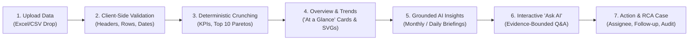
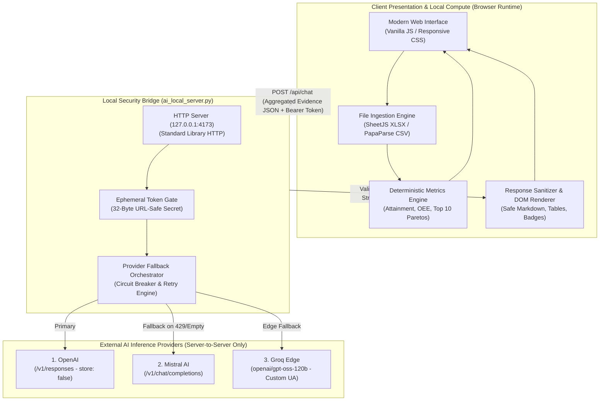
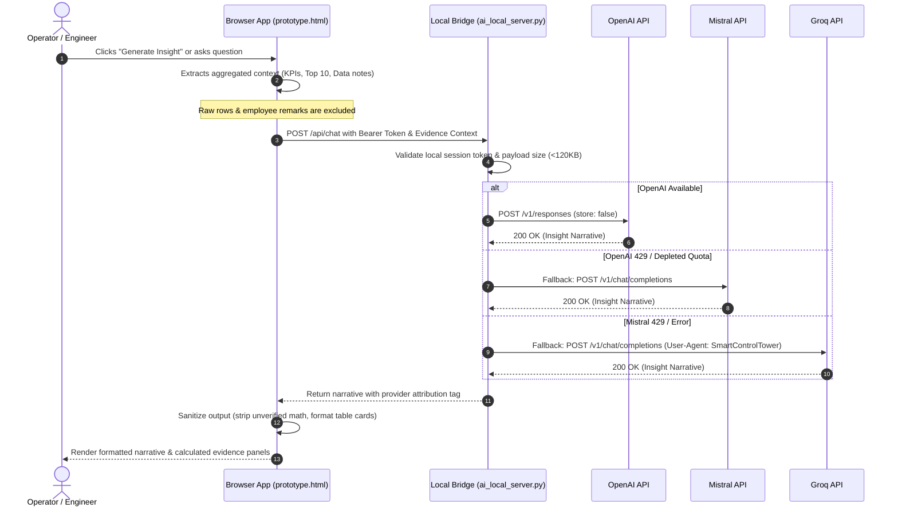
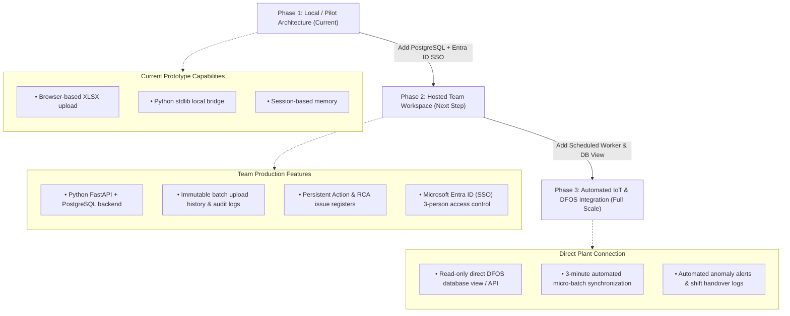

# Smart Control Tower: System Documentation & Architecture Guide
**Amber Press Shop · Daily Performance Review & Evidence-Linked Operational Intelligence**

---

# PAGE 1: SYSTEM OVERVIEW & HOW IT WORKS

## 1. Executive Summary & Purpose
The **Smart Control Tower** is a private, auditable operational workspace designed for Amber's press-shop plant leadership and engineering teams. While existing factory-floor **DFOS (Digital Factory Operating System)** displays provide near-live shift monitoring on physical screens, they lack persistent historical reconciliation, automated causal analysis, and closed-loop corrective action tracking.

The Smart Control Tower bridges this gap by providing:
- **Unified Daily Review:** Harmonizing disparate daily exports across production output, detailed equipment downtime, and quality rejections.
- **Evidence-Linked Intelligence:** Deterministic data aggregation paired with grounded AI interpretation—eliminating intuition-based guesswork and spreadsheet errors.
- **Auditable Accountability:** Linking observed machine anomalies directly to root-cause investigation cases and corrective action follow-through.

```
+-----------------------------------------------------------------------------------------------------+
|                                    CORE OPERATIONAL PRINCIPLE                                       |
|                                  "App Calculates, AI Explains"                                      |
|                                                                                                     |
|   1. The deterministic engine calculates all sums, rates, rankings, and mathematical checks.        |
|   2. The AI assistant strictly interprets verified facts and suggests qualitative shop-floor checks.|
|   3. Zero LLM hallucination: LLMs are strictly forbidden from recalculating or inventing numbers.  |
+-----------------------------------------------------------------------------------------------------+
```

---

## 2. The Three Ingested Reports & Grain Reconciliation

The system accepts three distinct operational data feeds, automatically profiling and cross-referencing them:

| Report Type | Primary Source Grain | Captured Metrics | Operational Role |
| :--- | :--- | :--- | :--- |
| **1. Production Dashboard** | Date + Machine + Model / Shift | Planned Qty, Actual Output, Rejection Count, Operating Uptime, Recorded Downtime | Macro production attainment, machine utilization, and baseline availability. |
| **2. Detailed Downtime Report** | Date + Machine + Event Interval | Total Downtime, Planned vs. Unplanned Minutes, Recorded Loss Reason, Remarks | Micro-loss diagnosis, top reason Pareto analysis, and MTTR/frequency tracking. |
| **3. Quality Rejection Report** | Date + Machine + Model / SKU | Production Qty, Rejected Qty, Defect Reasons (Gram/Pieces), Inspection Remarks | Defect classification (Hamming NG, Damage, Dent, etc.) and scrap-rate spikes. |

### Data Harmonization & Reconciliation Rules
* **Granularity Matching:** Reports connect when `Date` and normalized `Machine Name` align. Hour/Shift/Model matching is applied when granular timestamps exist.
* **Non-Destructive Profiling:** Source files are ingested append-only. Raw entries are preserved verbatim alongside standardized canonical mappings (e.g., standardizing `Cell-1_PP-20-200Ton` variants).
* **Mathematical Integrity Checks:** Downtime records must satisfy `Total Downtime = Planned Downtime + Unplanned Downtime`. If source fields fail reconciliation or rows are incomplete, the system automatically tags them with data-integrity warnings and suppresses misleading share calculations.

---

## 3. End-to-End User Operational Journey



1. **Upload & Preflight:** The user uploads daily workbooks via drag-and-drop. The client validates schemas, column headers, duplicate rows, and date spans in real time.
2. **Reviewing "At a Glance":** Production attainment, availability, OEE components, and downtime trends immediately populate deterministic KPI cards and interactive charts.
3. **Triggering AI Insights:** 
   - **Monthly Overview:** Runs on-demand to summarize monthly volume losses, macro shifts, and recurring bottleneck cells.
   - **Daily Diagnostic:** Generates targeted findings for any selected date, highlighting top unplanned downtime drivers and scrap spikes.
4. **Ad-Hoc Investigation via "Ask AI":** Operators use a dedicated floating assistant to query anomalies (e.g., *"Why did Cell 1 have 798 unplanned minutes on Dec 1?"*). The response cites exact source rows and distinguishes confirmed facts from hypotheses.
5. **Action Logging & Effectiveness:** Operational findings can be promoted into persistent action items with assigned owners, due dates, and recurrence checks.

---
---

# PAGE 2: INTERNAL ARCHITECTURE & LOGICAL WORKFLOW

## 1. System Architecture Overview

The Smart Control Tower utilizes a decoupled, secure hybrid architecture combining a high-performance browser client with a secure, tokenized local/backend API bridge:



---

## 2. Detailed Subsystem Workflows

### A. Data Ingestion & Client Compute Pipeline
1. **File Parsing:** Workbooks are read directly in-memory using client-side JavaScript. Raw data rows are stored only within the active session memory and never persisted externally without user intent.
2. **Deterministic Metric Aggregation:** 
   - Aggregates daily production volume, actual vs. plan attainment, and scrap percentages.
   - Computes **Top 10 Downtime Reasons** (ranked by unplanned downtime minutes) and **Top 10 Rejection Reasons** (ranked by rejected piece counts).
   - Generates machine-by-reason cross-tabulations to isolate machine-specific vulnerabilities.
3. **Data Quality Shield:** Evaluates reconciliation:
   $$\Delta_{\text{Downtime}} = \text{Total Minutes} - (\text{Planned Minutes} + \text{Unplanned Minutes})$$
   When $\Delta_{\text{Downtime}} \neq 0$ or fields are missing, the UI sets explicit reconciliation warnings and suppresses derived percentage shares.

---

### B. AI Inference Orchestration & Fallback Engine
The server component ([`ai_local_server.py`](file:///D:/HMC/Amber%20All/Soma%20ji/Smart%20Control%20Tower/ai_local_server.py)) provides a resilient AI proxy with zero external dependencies:



---

### C. Security, Privacy & Boundary Protection

| Boundary Layer | Implemented Control | Security Rationale |
| :--- | :--- | :--- |
| **Local Binding** | `127.0.0.1` single-tenant binding | Server never accepts inbound connections from the external local area network. |
| **Token Authorization** | 32-byte cryptographically random token (`secrets.token_urlsafe`) | Prevents cross-site request forgery (CSRF) or unauthorized local processes from invoking endpoints. |
| **Payload Privacy** | Context minimization & anonymization | Full raw spreadsheets never leave the user's browser. Only bounded statistical summaries are transmitted to AI APIs. |
| **Credential Safety** | Environment segregation (`.env` vs `.env.example`) | API keys reside server-side, never exposed to browser network inspectors, and excluded via `.gitignore`. |
| **Zero-Retention Inference** | `store: false` enabled on supported APIs | Ensures vendor API endpoints do not store proprietary factory metrics for model training. |

---

## 3. Production Roadmap Evolution



* **Phase 1 (Current Pilot):** Standalone zero-install prototype validating operator adoption, prompt quality, and reconciliation logic.
* **Phase 2 (Enterprise Team App):** Centralized deployment (FastAPI + PostgreSQL on private intranet or approved Azure tenant) supporting multi-user persistence, audit trails, and action tracking.
* **Phase 3 (Continuous IoT Feed):** Transition from daily manual spreadsheet uploads to automated, read-only DFOS database connectors.
